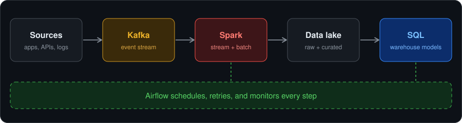

<h1 align="center">Narean Karthikeyan K</h1>

<b>Software Engineer &nbsp;|&nbsp; Data Engineering</b>

<i>Java · SQL · Spark · Kafka · Airflow</i>

  

---

## About me

I'm a software engineer focused on **data engineering**. I design pipelines that collect, process, and deliver data at scale, from real-time event streams to scheduled batch jobs.

- Learning: **data modeling, Delta Lake / Iceberg, cloud data platforms, and data quality testing**
- Ask me about: **Kafka, Spark, Airflow, SQL tuning, and Java**

---

## How I think about data

  

---

## Tech stack

  
  
  
  
  

| Layer | What I use it for |
| :-- | :-- |
| **Java** | Kafka producers and consumers, Spark applications, backend services |
| **SQL** | Window functions, CTEs, query tuning, dimensional modeling |
| **Apache Spark** | Batch ETL and Structured Streaming, partitioning and shuffle tuning |
| **Apache Kafka** | Event streaming, topics and partitions, consumer groups |
| **Apache Airflow** | DAG scheduling, retries, backfills, SLAs and alerting |

---

## Data engineering checklist I follow

- [x] Idempotent jobs, so reruns never create duplicates
- [x] Schema validation and data quality checks before loading
- [x] Retries, alerts, and backfill support in every DAG
- [x] Partitioning and file size tuned for Spark performance
- [x] Documented data flow for every pipeline

---

## Connect with me

  &nbsp;&nbsp;&nbsp;
  &nbsp;&nbsp;&nbsp;
  &nbsp;&nbsp;&nbsp;
  

---

<i>Good data is trusted data. Let's build pipelines people can rely on.</i>

