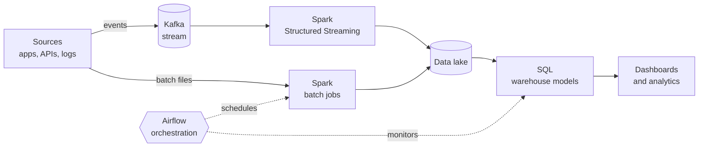

<h1 align="center">Narean Karthikeyan K</h1>

  

  
  

---

## About me

I'm a software engineer focused on **data engineering**. I design pipelines that collect, process, and deliver data at scale, from real-time event streams to scheduled batch jobs.

- Building: **[your current pipeline project]**
- Learning: **data modeling, Delta Lake / Iceberg, cloud data platforms, and data quality testing**
- Ask me about: **Kafka, Spark, Airflow, SQL tuning, and Java**

---

## How I think about data

---

## Tech stack

  
  
  
  
  

| Layer | What I use it for |
| :-- | :-- |
| **Java** | Kafka producers and consumers, Spark applications, backend services |
| **SQL** | Window functions, CTEs, query tuning, dimensional modeling |
| **Apache Spark** | Batch ETL and Structured Streaming, partitioning and shuffle tuning |
| **Apache Kafka** | Event streaming, topics and partitions, consumer groups, exactly-once ideas |
| **Apache Airflow** | DAG scheduling, retries, backfills, SLAs and alerting |

---

## Featured projects

<table>
  <tr>
    <td width="50%" valign="top">
      <h3>Real-time clickstream pipeline</h3>
      <b>Problem:</b> Website events arrive faster than batch reports can handle. 
      <b>Solution:</b> Kafka ingests events, Spark Streaming aggregates them in windows, results land in a SQL table. 
      <b>Result:</b> <i>[events per second, latency, e.g. "under 5 s end to end"]</i>  
      
      
        
      <a href="https://github.com/YOUR_USERNAME/clickstream-pipeline">Code</a>
    </td>
    <td width="50%" valign="top">
      <h3>Daily batch ETL with Airflow</h3>
      <b>Problem:</b> Raw data needs cleaning and loading every night, with failures handled. 
      <b>Solution:</b> An Airflow DAG runs Spark jobs, validates the data, and loads warehouse tables. 
      <b>Result:</b> <i>[rows per run, runtime, e.g. "50M rows in 12 min"]</i>  
      
      
        
      <a href="https://github.com/YOUR_USERNAME/airflow-etl">Code</a>
    </td>
  </tr>
  <tr>
    <td width="50%" valign="top">
      <h3>Fraud detection stream</h3>
      <b>Problem:</b> Suspicious transactions need flagging in seconds, not hours. 
      <b>Solution:</b> Kafka transactions are scored by rules in Spark, alerts go to a separate topic. 
      <b>Result:</b> <i>[detection delay, accuracy on test data]</i>  
      
        
      <a href="https://github.com/YOUR_USERNAME/fraud-stream">Code</a>
    </td>
    <td width="50%" valign="top">
      <h3>SQL optimization lab</h3>
      <b>Problem:</b> Slow queries hurt dashboards and costs. 
      <b>Solution:</b> A collection of before and after query rewrites with execution plan notes. 
      <b>Result:</b> <i>[e.g. "queries up to 20x faster"]</i>  
        
      <a href="https://github.com/YOUR_USERNAME/sql-optimization-lab">Code</a>
    </td>
  </tr>
</table>

---

## Data engineering checklist I follow

- [x] Idempotent jobs, so reruns never create duplicates
- [x] Schema validation and data quality checks before loading
- [x] Retries, alerts, and backfill support in every DAG
- [x] Partitioning and file size tuned for Spark performance
- [x] Documented data flow for every pipeline

---

## GitHub stats

  
  

---

## Connect with me

  
  
  
  

---

<i>Good data is trusted data. Let's build pipelines people can rely on.</i>

